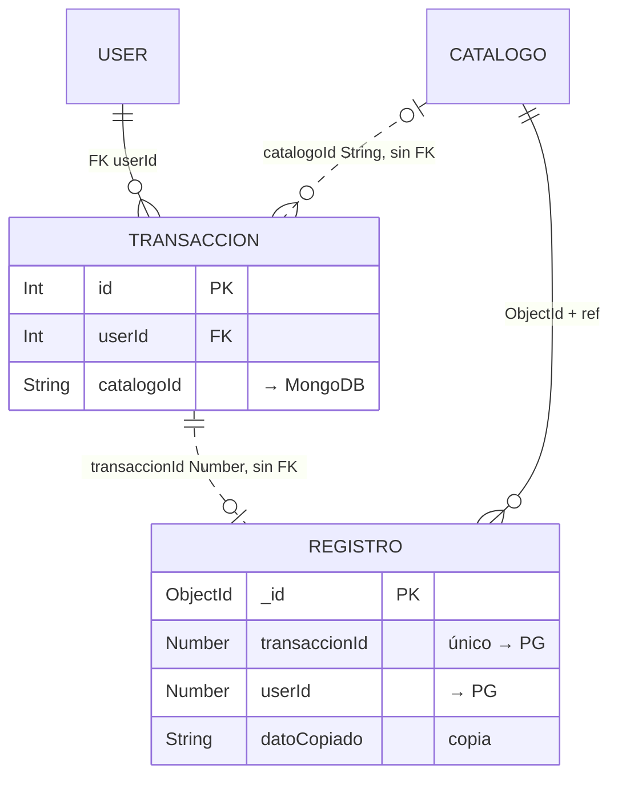

# Tarea individual U2 · Modelo híbrido PostgreSQL + MongoDB

**Estudiante:** Bonilla Caiza David Alejandro  **N.º de lista:** 2  **Caso:** 2 · Gimnasio

> Mismo formato que el workload del material de Modelado (lección 2.2) y que el ejemplo resuelto de la clínica
> (`docs/ejemplo_clinica/Workload_clinica_hibrida.md`). Cada operación agrega la fila **Base**.

## 1. Workload

### 1.1 Casos de uso
- Un gimnasio con ~1 200 socios ofrece **clases grupales** (spinning, yoga, crossfit, funcional, pilates…). Cada clase tiene un **cupo máximo** por sesión.
- El socio consulta el **catálogo de clases**: nivel, instructor, cupo, equipamiento y los **horarios de la temporada**.
- El socio se **inscribe** en una sesión de una clase (una fecha y uno de sus horarios) y puede cancelar su inscripción.
- El socio ve su **historial de inscripciones** con el nombre, el nivel y el horario de cada clase.
- Después de asistir, el socio **valora la clase**: nota de 1 a 5, comentario y etiquetas (una valoración por inscripción).
- Socios e instructores leen las **valoraciones de una clase** con su promedio y total.
- El administrador mantiene el catálogo: crea clases, **cambia los horarios cada temporada**, ajusta cupo y nivel, y elimina las clases que ya no se dictan.

### 1.2 Datos principales (cuántos actores, cuántos registros, cuánto tiempo se guardan)
- Socios: 1 200 activos (crecen ~40 por mes).
- Instructores: 15 · Administradores: 2.
- Clases en el catálogo: ~25, cada una con 3 a 6 horarios por semana → ~120 sesiones por semana.
- Cupo por sesión: entre 10 y 30 personas (promedio 20).
- Inscripciones: 120 sesiones × ~17 inscritos ≈ 2 000 por semana ≈ **300 por día**, con picos a las 6:00 y a las 18:00.
- Valoraciones: ~40 % de las inscripciones ≈ **120 por día**. **Crecen sin límite** (~43 000 por año).
- Temporadas: 4 por año (el horario cambia cada trimestre).
- Período: las inscripciones y valoraciones se guardan 3 años (historial del socio y reputación de cada clase).

### 1.3 Suposiciones (lo que puede cambiar)
- **El cupo es un límite duro**: si dos socios se inscriben a la vez en el último lugar, solo uno puede entrar (integridad fuerte, necesita transacción).
- Un socio no se inscribe dos veces en la misma sesión (misma clase, fecha y horario).
- **El horario cambia cada temporada**; el resto de la clase (nombre, nivel, descripción) casi no cambia.
- Cada clase tiene **forma distinta**: número variable de horarios y equipamiento o requisitos propios (spinning: bicicleta; yoga: mat; crossfit: nivel mínimo).
- Una inscripción tiene como máximo **una** valoración y solo la deja el socio dueño de esa inscripción.
- El nombre del socio casi nunca cambia: se puede copiar en la valoración para mostrarla sin consultar PostgreSQL.
- Las valoraciones se muestran por clase, las más nuevas primero, con el promedio.
- El catálogo se lee mucho más de lo que se escribe: se consulta en cada visita a la app y se edita pocas veces por temporada.
- Una clase con inscripciones no se puede borrar (se perdería el historial); una sin inscripciones sí, junto con sus valoraciones.

### 1.4 Operaciones (mínimo 6, una tabla por operación)

**Op. 1 · Consultar el catálogo de clases**

| Actor: | Socio (o visitante) |
|---|---|
| Descripción: | Consulta el catálogo de clases para elegir a cuál inscribirse |
| Tipo de operación: | Lectura |
| Datos en la operación: | nombre, nivel, instructor, cupo, duración, `horarios[]` de la temporada, `equipamiento[]` |
| Frecuencia: | En cada visita a la app; ~700 socios activos al día, ~4 vistas cada uno |
| Tasa: | 700 socios × 4 vistas = **2 800 / día** |
| Base: | **MongoDB**: el documento de la clase trae sus horarios embebidos y sale listo para mostrar en una sola consulta |

**Op. 2 · Inscribirse en una sesión**

| Actor: | Socio |
|---|---|
| Descripción: | Se inscribe en una sesión de una clase (fecha y hora de uno de sus horarios) |
| Tipo de operación: | Escritura |
| Datos en la operación: | `claseId`, `fechaSesion`; `userId` del JWT; `cupo` leído de la clase |
| Frecuencia: | Todos los días, con picos a las 6:00 y a las 18:00 cuando se abren los cupos |
| Tasa: | 120 sesiones/semana × 17 inscritos ≈ 2 000/semana ≈ **300 / día** |
| Base: | **PostgreSQL**: el cupo es un límite duro y dos socios pueden pelear el último lugar; se cuenta y se inserta en una transacción. Lee **MongoDB** para validar que `claseId` exista y obtener el cupo |

**Op. 3 · Cancelar una inscripción**

| Actor: | Socio |
|---|---|
| Descripción: | Cancela una inscripción suya y libera el lugar |
| Tipo de operación: | Escritura |
| Datos en la operación: | `id` de la inscripción; `userId` del JWT (solo el dueño) |
| Frecuencia: | ~1 de cada 10 inscripciones |
| Tasa: | 300 × 10 % = **30 / día** |
| Base: | **PostgreSQL**: cambia el conteo del cupo, que vive en la misma tabla transaccional |

**Op. 4 · Ver el historial de inscripciones**

| Actor: | Socio |
|---|---|
| Descripción: | Ve sus inscripciones con el nombre, el nivel y el instructor de cada clase |
| Tipo de operación: | Lectura |
| Datos en la operación: | inscripciones (`fechaSesion`, estado) de PostgreSQL + `nombre`, `nivel`, `instructor` de MongoDB |
| Frecuencia: | Cada socio activo, ~1 vez al día |
| Tasa: | 700 socios × 1 = **700 / día** |
| Base: | **Las dos**: se une en el servicio con `$in` + `Map` (2 consultas, sin N+1) |

**Op. 5 · Valorar una clase**

| Actor: | Socio |
|---|---|
| Descripción: | Después de asistir, valora la clase de una inscripción suya |
| Tipo de operación: | Escritura |
| Datos en la operación: | `inscripcionId`, `puntuacion` (1–5), `comentario`, `etiquetas[]`; `userId` del JWT; `nombreSocio` copiado de PostgreSQL |
| Frecuencia: | ~40 % de las inscripciones; una sola por inscripción |
| Tasa: | 300 × 40 % = **120 / día** (sin límite en el tiempo: ~43 000 por año) |
| Base: | **MongoDB**, colección aparte; lee **PostgreSQL** para validar que la inscripción exista (404) y sea del socio (403) |

**Op. 6 · Leer las valoraciones de una clase**

| Actor: | Socio o instructor |
|---|---|
| Descripción: | Lee las valoraciones de una clase, las más nuevas primero, con el promedio y el total |
| Tipo de operación: | Lectura |
| Datos en la operación: | `nombreSocio`, `puntuacion`, `comentario`, `etiquetas`, `createdAt`; promedio y total (aggregate) |
| Frecuencia: | Al abrir el detalle de una clase, ~2 de cada 4 vistas del catálogo |
| Tasa: | 2 800 × 50 % ≈ **1 400 / día** |
| Base: | **MongoDB** solamente (por eso se copia `nombreSocio`: no se consulta PostgreSQL al listar) |

**Op. 7 · Ver la lista de inscritos de una sesión**

| Actor: | Instructor |
|---|---|
| Descripción: | Antes de dar la clase, revisa quiénes están inscritos y cuántos lugares quedan |
| Tipo de operación: | Lectura |
| Datos en la operación: | inscripciones de (`claseId`, `fechaSesion`) + nombre del socio (`User`) |
| Frecuencia: | Una vez por sesión, a veces dos |
| Tasa: | 120 sesiones/semana × 2 ÷ 7 ≈ **35 / día** |
| Base: | **PostgreSQL** (Inscripción + User con JOIN por FK; usa el índice de `claseId`) |

**Op. 8 · Crear o editar una clase (cambio de temporada)**

| Actor: | Administrador |
|---|---|
| Descripción: | Crea una clase o cambia sus horarios, cupo o nivel al iniciar cada temporada |
| Tipo de operación: | Escritura |
| Datos en la operación: | todos los campos de la clase, incluido `horarios[]` completo |
| Frecuencia: | Concentrada al inicio de cada temporada (4 por año) y ajustes sueltos |
| Tasa: | 25 clases × 4 temporadas = 100/año + ajustes ≈ **15 / mes** |
| Base: | **MongoDB**: cada clase tiene horarios y equipamiento distintos; cambiar la forma no requiere migración |

**Op. 9 · Eliminar una clase**

| Actor: | Administrador |
|---|---|
| Descripción: | Elimina una clase que ya no se dicta |
| Tipo de operación: | Escritura |
| Datos en la operación: | `_id` de la clase; conteo de inscripciones que la usan en PostgreSQL |
| Frecuencia: | Casi nunca, al cerrar una temporada |
| Tasa: | **~5 / año** |
| Base: | **MongoDB**, revisando **PostgreSQL**: 409 si tiene inscripciones; si no, borra la clase y en cascada sus valoraciones |

### 1.5 Entidades

- **PostgreSQL**
  - User
    - Inscripcion (1:N, FK `userId`)
- **MongoDB**
  - Clase
    - `horarios[]` (embebido: día, hora de inicio, hora de fin, temporada)
    - `equipamiento[]` (embebido)
    - Valoracion (1:N, `clase` ObjectId + `ref`)
  - Valoracion
    - `etiquetas[]` (embebido)
- **Entre bases (sin FK)**
  - `Inscripcion.claseId` → `Clase._id` (**String**, 24 hex)
  - `Valoracion.inscripcionId` → `Inscripcion.id` (**Number**, único)
  - `Valoracion.userId` → `User.id` (**Number**) · `Valoracion.nombreSocio` (copia de `User.name`)

### 1.6 Observaciones (qué domina: lectura o escritura, qué crece sin límite, qué necesita integridad)
- **Domina la lectura**: ~4 900 lecturas (ops. 1, 4, 6, 7) frente a ~450 escrituras al día (ops. 2, 3, 5, 8, 9), unas **11 lecturas por cada escritura**. Lo que más se lee (catálogo y valoraciones) debe salir de una sola consulta: por eso los horarios van embebidos en la clase y `nombreSocio` se copia en la valoración.
- **Crece sin límite**: las valoraciones (~43 000 por año). Van en su propia colección, nunca embebidas en la clase (límite de 16 MB por documento).
- **Necesita integridad**: la inscripción. El cupo es un límite duro y los picos de las 6:00 y 18:00 provocan inscripciones simultáneas al último lugar; además no se puede duplicar la inscripción. Se queda en PostgreSQL con transacción.
- **Cambia de forma**: la clase (horarios distintos cada temporada, equipamiento variable). Va a MongoDB, donde cambiar la forma no necesita migración.
- **El punto delicado**: el cupo es un dato de la clase (MongoDB), pero la regla se cumple en PostgreSQL. El servicio lee el cupo de MongoDB y, dentro de una transacción de PostgreSQL, cuenta los inscritos de esa sesión antes de insertar.
- **Índices que pide el workload**: `Inscripcion.claseId` (`@@index`) y único (`userId`, `claseId`, `fechaSesion`) en PostgreSQL; `valoraciones.inscripcionId` único y `valoraciones { clase: 1, createdAt: -1 }` en MongoDB.

## 2. ¿PostgreSQL o MongoDB?

| Entidad | ¿Transacciones o choques? | ¿Otras dependen por FK? | ¿Forma variable? | ¿Crece sin límite? | ¿Se lee mucho más? | Base |
|---|---|---|---|---|---|---|
| **User** | Sí: el registro choca si el email ya existe (`@unique`) | **Sí**: Inscripcion depende por FK `userId` | No: campos fijos (name, email, password, role) | No: ~40 socios nuevos por mes | Sí (login), pero es un registro pequeño | **PostgreSQL** (ya existe con el login y otra tabla depende de él por FK) |
| **Inscripcion** | **Sí**: el cupo es límite duro; en los picos de las 6:00 y 18:00 varios socios piden el último lugar a la vez, y no se puede duplicar (`userId`, `claseId`, `fechaSesion`) | Sí: depende de User por FK; Valoracion la referencia (Number, sin FK) | No: forma fija (`userId`, `claseId`, `fechaSesion`, `estado`, `createdAt`) | Crece (~300 por día) pero con forma fija, por índice y acotada a 3 años (~330 000 filas) | No: equilibrada, ~735 lecturas frente a ~330 escrituras al día | **PostgreSQL** (transacción para el cupo y restricción única) |
| **Clase** | No: solo la edita el administrador, ~15 veces al mes, sin choques | No por FK: Inscripcion guarda su `_id` como String y el servicio protege el borrado (409) | **Sí**: `horarios[]` distintos cada temporada, `equipamiento[]` y requisitos propios de cada clase | No: ~25 clases; cada una con 3 a 6 horarios (acotado → se embeben) | **Sí**: ~2 800 lecturas al día frente a ~15 escrituras al mes | **MongoDB** (documento listo para leer, con sus horarios embebidos) |
| **Valoracion** | No: cada socio escribe la suya; el único choque (dos valoraciones de la misma inscripción) lo resuelve un índice único → 409 | No: ninguna entidad depende de ella | Algo: `etiquetas[]` variables y comentario opcional | **Sí**: ~120 por día, ~43 000 por año, sin límite | **Sí**: ~1 400 lecturas frente a ~120 escrituras al día (~12:1) | **MongoDB**, colección propia (nunca embebida en Clase por el límite de 16 MB) |

**Resumen de la decisión**
- Va a **PostgreSQL** lo que tiene choques que exigen transacción o de lo que otra tabla depende por FK: **User** e **Inscripcion**.
- Va a **MongoDB** lo que cambia de forma, se lee mucho más de lo que se escribe o crece sin límite: **Clase** y **Valoracion**.
- El cupo cruza las dos bases: el número vive en la **Clase** (MongoDB) y la regla se cumple al insertar la **Inscripcion** (PostgreSQL, en transacción).

## 3. Relaciones dentro de MongoDB: embeber o referenciar

| Relación | Cardinalidad | ¿Se lee junto? | ¿Cambia seguido? | ¿Crece sin límite? | Decisión |
|---|---|---|---|---|---|
| | | | | | |

## 4. ERD híbrido (notación pata de gallo, como el material 2.1)

Dos zonas, PostgreSQL y MongoDB; cada entidad con sus campos y tipos; lo embebido dentro de la entidad (`campo: [Tipo]`).
Línea continua: FK de PostgreSQL o `ref` de Mongoose. **Línea punteada: referencia entre bases** (sin FK).
Puede entregarlo como imagen (draw.io, Lucidchart) o con Mermaid, que GitHub dibuja solo:

## 5. Referencias

| Referencia | Se guarda como | La garantiza | Se une con |
|---|---|---|---|
| | | | |

## 6. Dato copiado entre bases (desnormalización)

- Dato:
- Por qué (operación del workload):
- Costo:

## 7. Endpoints

| Método y ruta | Base(s) | Respuestas posibles |
|---|---|---|
| | | |
